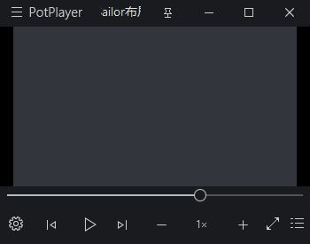
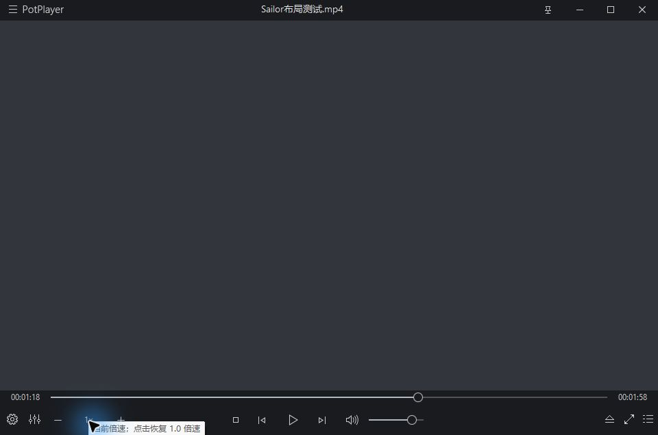

# Sailor优化版

一款为 PotPlayer 制作的紧凑暗色皮肤，项目名 **potplayer-skin**。把常用的倍速操作直接放在底部进度栏，并提供克制的金属色配色与自定义主题工具。

**当前版本：v1.0.2** · Windows / PotPlayer · [MIT](LICENSE)

[下载最新版本](https://github.com/lifan54a/potplayer-skin/releases/latest) · [变更记录](CHANGELOG.md) · [验证范围](docs/VALIDATION.md)

## 设计与功能

- **底部内嵌倍速**：`−  当前倍速  +` 与播放键处于同一行；进度条独立位于其上方。全部控件限制在预留的 65 像素底栏内。
- **轻量交互**：与底栏融为一体的图标、灰色数值和主题色悬停反馈。
- **实时速度**：中间读取播放器当前速度，点击即可恢复正常速度；两侧按钮右键也能复位。
- **各布局保留倍速**：播放或暂停、窗口宽窄变化时，倍速仍在底栏内。是否隐藏整个底栏，由 PotPlayer 设置控制。
- **统一品牌**：空闲画面显示 `Sailor优化版`，皮肤说明采用同一名称。
- **视频与音频一致**：普通界面与屏幕控制界面的四个底栏布局使用同一套倍速交互。
- **按可用宽度适配**：宽窗居中播放，中窗收紧布局，极窄区域保留播放和倍速；附加播放列表不占用播放器底栏的布局宽度。
- **主题可自定义**：调整强调色和暗色背景，导出自己的 `.dsf`；不需要安装第三方模块。

## 配色

| 主题 | 强调色 | 暗色底 | 取向 |
| --- | --- | --- | --- |
| 铂金灰 | `#BCC5CF` | `#191B1F` | 中性银灰，默认方案 |
| 香槟金 | `#C5B18A` | `#1E1C19` | 低饱和暖金，搭配暖炭色 |
| 烟铜 | `#BB9B8D` | `#211C1A` | 烟灰与浅铜，偏温暖 |
| 钛蓝 | `#93A8B8` | `#191E23` | 灰蓝金属色，搭配冷炭色 |

主题色用于进度条、主要强调图标和交互状态；普通文字保持灰色。主题修改不会对视频画面、封面内容或外部字幕进行滤色。资源中少量非蓝色状态图标可能保留自身颜色。

## 安装

1. 在 [Releases](https://github.com/lifan54a/potplayer-skin/releases/latest) 下载一款 `.dsf`，或下载全部主题压缩包；源码的 `dist/` 也包含相同皮肤。
2. 打开 PotPlayer，按 **F5**，进入 **基本 → 皮肤/配色**，点击 **打开皮肤文件夹**。不同版本的栏目可能显示为“默认皮肤”。
3. 将 `.dsf` 文件复制到打开的 `Skins` 文件夹。不要解压 `.dsf`，也不要把整个项目放进去。
4. 在播放器画面上 **右键 → 皮肤**，选择刚复制的文件；列表没有刷新时重启播放器。
5. 如果你希望底栏始终可见，取消皮肤设置中的 **视频下自动隐藏**。全屏模式还可能受到屏幕控制/OSC 的自动隐藏设置影响。

已安装其他版本时，建议保留旧文件，用新的独立文件名安装，方便切回。

### 直接下载 v1.0.2

| 主题 | 下载 |
| --- | --- |
| 铂金灰（默认） | [Sailor-Platinum-v1.0.2.dsf](https://github.com/lifan54a/potplayer-skin/releases/download/v1.0.2/Sailor-Platinum-v1.0.2.dsf) |
| 香槟金 | [Sailor-Champagne-v1.0.2.dsf](https://github.com/lifan54a/potplayer-skin/releases/download/v1.0.2/Sailor-Champagne-v1.0.2.dsf) |
| 烟铜 | [Sailor-Copper-v1.0.2.dsf](https://github.com/lifan54a/potplayer-skin/releases/download/v1.0.2/Sailor-Copper-v1.0.2.dsf) |
| 钛蓝 | [Sailor-Titanium-v1.0.2.dsf](https://github.com/lifan54a/potplayer-skin/releases/download/v1.0.2/Sailor-Titanium-v1.0.2.dsf) |

完整源码包含主题配色工具；只安装皮肤时下载 `.dsf` 即可。发布页提供 `SHA256SUMS.txt`，可用于核对下载文件。

## 窗口适配与实机效果

底栏根据自己的可用宽度切换布局，数值不包括右侧附加播放列表：

| 可用宽度 | 布局 |
| --- | --- |
| 小于 350 像素 | 上一项、播放/暂停、下一项、倍速；隐藏设置、音量和窗口按钮 |
| 350–699 像素 | 紧凑排列；520 像素起显示音量；倍速位于右侧窗口按钮之前 |
| 700 像素及以上 | 播放控件组成独立居中组，倍速放在左侧设置按钮之后 |

进度条始终在独立的上方行；420 像素起显示两端时间。隐藏的次要功能仍可通过右键菜单访问。

已用本地生成的 640×360 纯色测试片，在可用宽度 350、640、960 像素下实测，确认视频画面不与倍速控件交叠；已测试播放列表开关、暂停状态、点击加速及点击数值恢复正常速度。

小窗实机效果：



宽窗实机效果：



## 倍速操作

| 操作 | 效果 |
| --- | --- |
| 左键点击 `−` | 降低播放速度 |
| 左键点击中间倍速 | 恢复正常速度 |
| 左键点击 `+` | 提高播放速度 |
| 右键点击 `−` 或 `+` | 恢复正常速度 |

每次加减的步长由 PotPlayer 的播放速度设置决定，皮肤不修改播放器的全局设置。直播或不可定位媒体可能不支持调速。未打开文件时，速度文字和按钮的可用状态取决于播放器。

## 自定义主题

建议在 Windows 上使用 **PowerShell 7**。脚本只读取项目内的素材，在本地生成皮肤，不联网，也不改注册表或播放器配置。

### 可视配色

在项目目录打开 PowerShell，运行：

```powershell
pwsh -File .\scripts\Theme-Designer.ps1
```

选择预设，或使用“自定义强调色”“自定义背景色”的颜色选择器，点击“生成皮肤文件”保存 `.dsf`。配色工具的预览是简化示意，实际显示应以 PotPlayer 内加载结果为准。建议保留深色背景与足够明亮的文字；工具允许自由选色，不会自动保证对比度。

### 命令行构建

```powershell
pwsh -File .\scripts\Build-Skin.ps1
```

自定义颜色与输出路径：

```powershell
pwsh -File .\scripts\Build-Skin.ps1 `
  -AccentColor '#C5B18A' `
  -BackgroundColor '#1E1C19' `
  -ThemeName '我的主题' `
  -OutputFile '.\dist\Sailor优化版_我的主题.dsf'
```

颜色格式为 `#RRGGBB`。每次都从 `src/` 的基础素材生成，重复导出不会累计失真。背景调色针对素材中的基础暗色像素，不会把所有阴影、分割线和状态色强行替换成同一种颜色。

## 项目结构

```text
potplayer-skin/
├─ src/                     皮肤布局、文案、图标与图片资源
│  ├─ VideoSkin.xml         视频与屏幕控制布局
│  ├─ AudioSkin.xml         音频布局
│  ├─ Logo.txt              Sailor 品牌文字
│  ├─ SpeedControls.png     透明加减图标及交互状态
│  └─ ...                   播放列表、控制面板及其素材
├─ scripts/
│  ├─ Build-Skin.ps1        调色、校验、打包及 SHA-256
│  ├─ Validate-Skin.ps1     引用、布局及控件校验
│  └─ Theme-Designer.ps1    本地可视配色工具
├─ dist/                    可直接安装的 DSF 文件
├─ docs/                    配色与验证说明
├─ CHANGELOG.md
└─ LICENSE
```

`.dsf` 是根目录直接包含布局和资源的 ZIP 封装。请使用构建脚本打包；如果多套一层文件夹，播放器可能无法识别。

## 验证与兼容性

```powershell
pwsh -File .\scripts\Validate-Skin.ps1
```

校验会检查：图片/包含文件引用、布局标签嵌套、调速命令、各布局底栏高度、最低宽度下时间/倍速/进度条的几何分区。调色后对全部 PNG 逐像素检查尺寸、DPI、透明度位置和非目标区域；构建后还会读取所有压缩包条目，检查是否可正常解压。

### v1.0.1 资源修复

早期审核包调色时把约 72 DPI 的图集绘制到默认 96 DPI 画布，导致图标放大和裁切，播放器仍按原坐标读取后出现红色块、按钮错位。v1.0.1 直接编辑原图像素，不通过新画布重绘；保留图集坐标、DPI 和透明度。请不要继续使用旧审核包，安装独立名称的修复版并切换到它，避免旧皮肤缓存。

**自动检查不能替代所有实机验证。** v1.0.2 已完成上面列出的普通视频窗口实测；全屏、音频界面与其他 DPI 组合仍待验收，详见 [验证清单](docs/VALIDATION.md)。皮肤布局使用 PotPlayer 自身语法和预处理指令，不适合直接当作标准 XML 全量解析。

建议先在较新的 Windows 版 PotPlayer 中试用。不同版本、渲染方式、DPI 与系统字体可能影响文字位置。本项目不修改解码器、音轨、字幕样式、视频色彩或播放文件。

## 常见问题

**倍速控件消失了？** 先确认整个底栏是否被自动隐藏。皮肤不能覆盖播放器的全局隐藏策略；关闭“视频下自动隐藏”，再检查全屏屏幕控制设置。

**换肤后仍显示旧样式？** 确认实际选择的是 `Sailor优化版_主题名`，切换到其他皮肤再切回，或重启播放器。不要混用旧的同名文件。

**点击加减后没有变化？** 检查媒体是否支持调速，尝试普通本地视频，并检查播放器的调速步长。

**速度显示精度与预览不一致？** 数值来自 `CMD_PLAY_SPEED_MESSAGE`，格式受播放器返回值影响；预览中的 `1.0×` 是示例。

**字体或间距不合适？** 请反馈 PotPlayer 版本、Windows 缩放比例、窗口尺寸和截图，特别说明是否处于全屏。

**如何恢复？** 右键 → 皮肤，切回默认或其他皮肤即可。配色导出不会自动安装，也不会替换你已使用的皮肤。

## 贡献与许可

欢迎反馈布局、配色和兼容性问题。涉及图标、字号和间距的变更，请附改前改后的对照及实际测试环境；只增加与播放器使用相关的控件。

项目按 [MIT 许可证](LICENSE) 发布。PotPlayer 应用程序本身不包含在本项目中，其名称与商标归相应权利人所有。本项目为独立皮肤项目。
